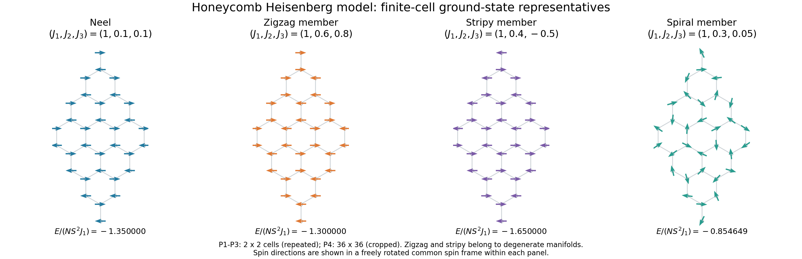
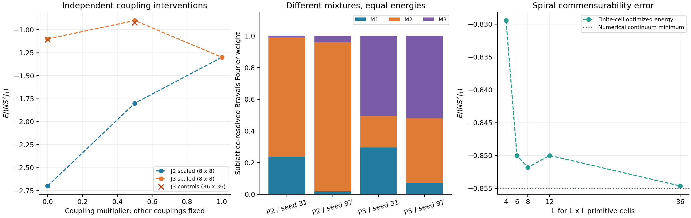

# 蜂窝晶格 J1–J2–J3：经典基态与竞争机制

2026-10-30。根据研究者选择，研究各向同性经典 Heisenberg 模型，以代表点检查 Néel、zigzag、stripy 与螺旋竞争。本轮完成 30 次实际求解调用，保留原始输入、完整模型、对称性检查、初态、计算结果、删项对照、干预证据及解释记录。它是代表点研究，不是完整相图。

## 结论

四类代表态均已找到。Néel 点的多初态结果为共线反铁磁态；zigzag 和 stripy 点的随机搜索得到不同的非共线多波矢组合，与对应共线态等能。螺旋点的波矢与能量受到有限胞公度条件影响。

在选定的 zigzag 点，删去第三近邻交换不能满足能量、态和采样谱的比较要求。独立干预表明：降低第二近邻交换会回到 Néel 态；降低第三近邻交换会离开原来的 zigzag 型 M 点基态族，出现调制态。结论限定于本报告的参数点和计算范围。



上图的共线 zigzag／stripy 是简并基态族的成员。它们由模型自身的 Fourier 最低模构造，并经通用实空间求解器检查。随机搜索结果没有被强行改成共线态。图中各面板允许整体自旋旋转，不引入各向异性。

## 模型、计数与约定

\[
H=J_1\sum_{\langle ij\rangle_1}\mathbf S_i\cdot\mathbf S_j
 +J_2\sum_{\langle ij\rangle_2}\mathbf S_i\cdot\mathbf S_j
 +J_3\sum_{\langle ij\rangle_3}\mathbf S_i\cdot\mathbf S_j.
\]

正交换为反铁磁，每条无向键计一次，无磁场、无各向异性、无层间耦合。每个站点的一、二、三近邻配位数分别为 3、6、3，每个两站点原胞保存 3、6、3 条独立键，共 12 项。所有代表点均通过 P6/mmm 的 24 个结构对称操作检查，没有降群或对称性修复。

最近邻距离取 1，原胞基矢和基底为：

\[
\mathbf a_1=(\sqrt3/2,3/2,0),\qquad
\mathbf a_2=(-\sqrt3/2,3/2,0),\qquad
\mathbf r_A=0,\quad \mathbf r_B=(\mathbf a_1+\mathbf a_2)/3.
\]

数据契约中第三基矢取 (0,0,8)，只用于存储互不耦合的平面。所有真实相互作用的层间平移为零。

统一取 J1=1。计算使用经典自旋长度 S=0.5 作为归一化约定；不进行量子基态计算。下文能量均为 **E/(N S² J1)**，因此可直接作为单位长度经典自旋的每站点能量理解。

## 四个代表点

| 点 | (J1,J2,J3) | 已验证的态 | 每站点归一化能量 |
| --- | --- | --- | ---: |
| P1 | (1,0.1,0.1) | Néel | -1.350000 |
| P2 | (1,0.6,0.8) | 包含共线 zigzag 的 M 点简并基态族 | -1.300000 |
| P3 | (1,0.4,-0.5) | 包含共线 stripy 的 M 点简并基态族 | -1.650000 |
| P4 | (1,0.3,0.05) | 螺旋／调制态，36×36 胞 | -0.854648614 |

P1–P3 在 4×4、6×6 原胞上的随机初态搜索和 2×2 的单波矢代表态给出一致能量。每次随机搜索含 6 个初态，4×4 还使用了两组独立随机种子。P4 另计算了 8×8、12×12，并用模型自身的 Fourier 模构造 36×36 的初态。

P4 的独立二维 Fourier 连续波矢数值最小化给出能量约 -0.855000000。36×36 结果高约 0.000351386。这个连续最小值来自网格搜索与多起点局部细化，未作区间算术的全局证明。

### 为何不能把 zigzag／stripy 当成唯一基态

令 C1、C2、C3 为各壳层平均自旋点积，除以 S²。实际结果为：

| 基态族 | C1 | C2 | C3 |
| --- | ---: | ---: | ---: |
| Néel | -1 | 1 | -1 |
| zigzag 型 | 1/3 | -1/3 | -1 |
| stripy 型 | -1/3 | -1/3 | 1 |

P2、P3 的不同随机种子，在三个对称相关的 M 点上分配不同 Fourier 权重，能量仍相同。自旋二阶矩有多个非零特征值，说明这些态确实非共线。另行构造的共线态也达到同一有限胞下界。这支持“简并基态族”的表述；未计算热或量子涨落对其成员的选择。这种经典简并也见于 [Fouet、Sindzingre 与 Lhuillier 的原始研究](https://arxiv.org/abs/cond-mat/0101421)，该文仅用于结果解释，未作为求解器的答案输入。

图中的 Fourier 权重是按子晶格分别求模后求和的 Bravais 波矢权重，不等同于含基底干涉与实验形状因子的散射强度。

## 删项与机制对照

以 P2=(1,0.6,0.8) 为完整模型，保持全部原结构对称性，提出删去整个 J3 壳层的候选。在匹配的 4×4 周期胞中，比较经典态和四个采样波矢的谐波谱。

| 指标 | 实测差异 | 声明容差 | 结果 |
| --- | ---: | ---: | --- |
| 每原胞能量差，原始计算单位 | 0.100000 | 0.01 | 不通过 |
| 候选态放回完整模型的能量惩罚，每原胞 | 0.607784 | 0.01 | 不通过 |
| 归一化自旋关联最大差 | 2.000000 | 0.05 | 不通过 |
| 采样谐波频率最大差 | 0.948586 | 0.01 | 不通过 |

这里的原始每原胞能量转为前述归一化每站点能量需乘 2。谐波频率保留求解器的 S=0.5、hbar=1 单位。谱比较包含磁超胞折叠，未计算展开权重。

简并态的两两关联距离也可能区分同一个基态族内的不同成员，因此不能只凭该距离断言相不同。本例的能量差和完整模型能量惩罚已提供独立的删项反例。

随后在 8×8 胞中独立缩放 J2 或 J3，另一壳层保持完整值：

| 干预 | (J1,J2,J3) | 能量 | 关联／波矢结果 |
| --- | --- | ---: | --- |
| 完整对照 | (1,0.6,0.8) | -1.300000 | zigzag 型 M 点基态族 |
| J2 关闭 | (1,0,0.8) | -2.700000 | Néel |
| J2 减半 | (1,0.3,0.8) | -1.800000 | Néel |
| J3 关闭 | (1,0.6,0) | -1.100000 | 多波矢调制态，明显受公度条件限制 |
| J3 减半 | (1,0.6,0.4) | -0.900000 | 非 M 点调制态 |

两个“能量变化不超过 0.01 原始每原胞单位”的忽略性假设均被反驳。这里的物理解释使用了额外保存的自旋关联和 Fourier 分布，不仅依赖标量能量。

对 J3 关闭和减半两个点，另构造 36×36 的模型导出单波矢态，经通用求解器检查，分别得到 -1.108333264 和 -0.922668160，均达到各自有限胞的 LT 下界。对应连续波矢数值最小值约为 -1.108333333 和 -0.925000000。因此 8×8 的能量收敛不代表连续波矢已经收敛。

### 从能量看两种交换的不同作用

用实测壳层关联可直接得到两个共线代表态的能量：

\[
e_{\mathrm{N\acute eel}}=\frac{-3J_1+6J_2-3J_3}{2},\qquad
e_{\mathrm{zigzag}}=\frac{J_1-2J_2-3J_3}{2},
\]

这里 e 的单位为每站点能量除以 S²。在这两个态之间，J3 的能量贡献相同；它们的相对能量由 J1 和 J2 决定。因此不能简单说“正 J3 直接使 zigzag 胜过 Néel”。本次对照显示，P2 的 J2 使 Néel 不再占优，而足够大的 J3 还抑制了所采样参数下的调制竞争态。两个共线能量相等的位置也不能直接作为完整相图边界，因为中间可能有更低能的螺旋态。

在 8×8 的 J3 关闭实验中，冻结原参考态时能量增加 1.2，允许态重排后降低 1.0，净变化只有 0.2，均为归一化每站点单位。这个分解说明：较小的总能量变化可以掩盖显著的相互作用贡献与态重排。



折线仅连接已计算的离散点，不表示参数间的相界已求出。8×8 与 12×12 允许的波矢集合不互相包含，因此能量不要求随这两种尺寸单调下降。

## 一次保留并修复的研究失败

P4 的 12×12 随机搜索给出能量 -0.849975785702，驻点残差约 3.20e-7，满足当时声明的 1e-6 驻点容差；但它高于该胞 LT 下界约 2.42143e-5。

验收检查识别出这个差距后，另从该模型的 Fourier 最低模构造等长度初态，重新调用同一求解器，得到 -0.850000000000，与有限胞下界在浮点精度内一致。原始搜索结果、第一次验收失败日志和修正后的结果全部保留。

这说明研究流程必须分别检查“驻点是否收敛”“有限胞基态是否找到”“波矢和尺寸是否充分”，不能由一个成功状态替代三者。

## 对工具下一步开发的建议

此次研究已通过现有三个阶段接口完成，模型不需要文献登记项。原始数值路线、对称性检查、简化否定证据、干预、任务恢复和证据报告均可用。以下分析目前主要由宿主 agent 在求解后完成：

1. **将基态判定接到能量下界和恢复动作。** 对存在可饱和 LT 下界的模型，自动识别“已驻定但高于下界”，保存失败后尝试模型导出的初态。
2. **增加波矢、壳层关联和简并诊断。** 将这些通用观测量纳入机制接口，区分单波矢、多波矢及同一简并族内的不同成员。
3. **让尺寸检查跟随波矢公度性。** 根据 Fourier 最小值选择后续胞，避免把某一个小周期胞的结果直接当作无限晶格磁序。

优先补齐这些诊断后，再做 J2–J3 参数扫描。热涨落／量子涨落的简并解除属于后续独立研究，不能从本轮经典零温结果推断。

## 证据与复跑

数值摘要见 [summary.json](summary.json)，实验代码见 [run_study.py](run_study.py) 和 [finish_study.py](finish_study.py)。通用接口生成的逐步报告分别位于 [P1](P1-report/report.md)、[P2](P2-report/report.md)、[P3](P3-report/report.md)、[P4](P4-report/report.md)，两个较大胞干预补算见 [J3 关闭](P2-J3-off-L36-report/report.md) 和 [J3 减半](P2-J3-half-L36-report/report.md)。

全部求解使用相同产品源码身份：`c3a8f9e1ec92808b87777795cd95eae97b12f3d851e541bc20e0f8518eaa0ba2`。本轮增加研究实验、后处理和报告，没有修改产品求解器。源文本经宿主解析后进入同一完整模型与对称性检查；未另行测量输入重建误差。

远端完整记录目录：

```
/data/work/zhli/soft/Design_Mott_Materials/.worktrees/literature-evidence-audit/translation-invariant-spin-model-simplifier/artifacts/honeycomb-j1j2j3-20261030-001
```

该目录保留首次脚本版本、最终脚本版本、原始失败日志、完成报告和全部 worker 结果。重复相同动作会复用已有记录；新的物理设置应使用新的动作标识。本地目录是可读报告、图件与摘要镜像，完整数值证据仍在 gpulzh。
